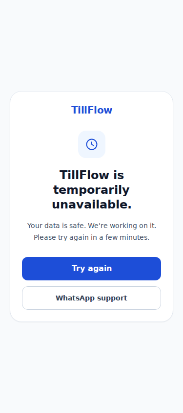
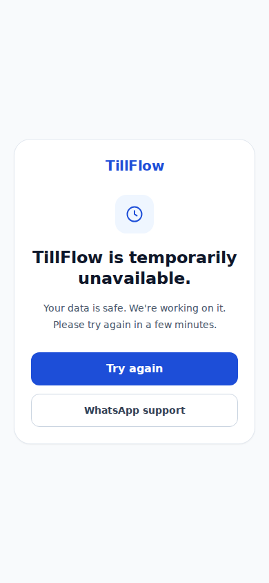

# Database outage handling and load review — 29 October 2026

Based on master `89698dabf976fa089e495ab936fc81046ea5b43c`. No production database, Neon configuration, or Vercel configuration was changed. The cron edit is proposed repository configuration only; it is not applied by this PR being opened.

## Failure handling

The protected layout catches connection failures before Next.js redacts server exception messages. P1001/P1017, initialization failures, timeout/pool/network connection failures and Neon quota/402 errors render the shared branded screen with the requested copy and WhatsApp support. Unexpected exceptions and Next.js redirects are rethrown; root and protected error boundaries display friendly generic copy without `error.message` or a technical digest. The root boundary also recognizes database exceptions if their identity survives serialization. An unrelated server error whose identity Next.js redacts deliberately receives generic copy; no guess based on the generic Server Components message is made.

Retry in a client error boundary uses Next.js reset. The layout's recovery screen reloads the page because the failed layout itself must run again. Neither screen promises offline selling: PosClient queues only when `navigator.onLine` is false or fetch fails, whereas a reachable app returning a database failure does not necessarily enter that path. A fresh request also cannot bypass the protected server layout merely because cached catalogue data exists. Existing capture/sync behaviour remains unchanged.

## Verified suspects and changes

- The attention banner was mounted only for an entitled business already, via `getFeatures(...).onlineStorefront` in the layout; its endpoint independently enforces entitlement. Keep both checks. Healthy visible polling remains 15 seconds. The endpoint already projects just the required fields and bounds the oldest-order list at five; no extra cache delays order visibility.
- A shared serial scheduler stops timers while hidden/offline, resumes on focus/visibility/online, deduplicates event bursts, and exponentially backs off rejected tasks. Attention errors go 30s → 60s → 120s, capped at 120s, returning to 15s after success. A request already in flight can complete; no new polling request starts while inactive. Component cleanup stops future scheduling and aborts the attention fetch. Router refresh has no awaitable failure result: do not pretend it has measurable exponential failure backoff.
- The final timer inventory also found pending MoMo collection checks (5 seconds), customer refund checks (15 seconds), and customer order-status fallback (20 seconds). These now use the same pause/serial/backoff scheduler. Pending MoMo failures cap at 30 seconds; customer status failures cap at 120 seconds. The customer status SSE connection closes while hidden/offline and reconnects on resume, preventing background listener/reconnect traffic. No payment is initiated by resume; it checks the existing collection/order. Cosmetic countdowns/animations and hourly service-worker update checks do not read the database and are unchanged.
- Owner dashboard and command centre refresh every 3 minutes, system health every 2 minutes, Trading every 5 minutes. Manual controls remain. Resume recovery is prompt and shared with the scheduler; surfaces without interval refresh keep the existing visibility hook with an added offline guard. Reports can therefore show older data while continuously visible; use Refresh for an immediate snapshot.
- OwnerStatusStrip and NetworkStatus were **local IndexedDB reads**, not Neon calls. Pause their periodic work when inactive too. A local queue-change event updates counts immediately after a successful queue write even while offline, avoiding a frozen pending-sales count. Explicit sync/reconnect/service-worker events remain intact.
- There are **three**, not two, five-minute crons. Expiry already has a narrow, bounded due-order query and does no transaction on an empty result. Paid-order retry already reads at most three IDs and does no posting work on an empty result. Preserve these cheap paths.
- Propose expiry every 15 minutes instead of 5. Default expiry is two hours; automatic cancellation and reservation release may now lag the deadline by up to about 15 minutes (previously about 5), plus execution time/backlog. The 100-order pass limit and transaction race checks are unchanged. Do not describe this as an exact payment-deadline extension.
- SMS dispatch and paid-order retry now also run every 15 minutes, aligned with expiry. This permits longer idle gaps without changing hosted settings. Their latency and drain-capacity trade-offs are listed below; actual suspension depends on traffic and the configured timeout.
- SMS dispatch previously updated every eligible row, fetched every claimed row including message bodies, then released overflow. Now read at most 50 IDs, return immediately if empty, atomically claim only those IDs while rechecking due/unlocked eligibility, and read only the claimed batch. Unique run markers and stale-lock recovery remain. Concurrent dispatchers can contend for the same candidate IDs; only the winner reads claims, and later runs handle remaining work. No unbounded over-lock/release pass remains.
- `/api/health` still performs a real `SELECT 1` and reports database down/503 accurately. Remove its two unrelated user/business counts, which were logged and absent from the response. Redis health semantics remain unchanged.
- The recurring owner forecast fetched complete journal-line and account rows merely to inspect debit, credit and account type. Project exactly those three fields. Owner dashboard, attention, expiry, retry and most forecast reads were already selective: no blind truncation of financial history or totals was introduced.

## Before/after estimates

Steady-state rates exclude initial render, manual actions, navigation and resume events. These are code-derived estimates, not production measurements. Auth/billing queries, nested relation queries and cache hits mean a request is not equivalent to one SQL statement.

| Work | Before | After |
| --- | --- | --- |
| Attention, entitled and visible/healthy | 240 HTTP requests/hour | 240/hour; same prompt cadence |
| Attention, hidden or device offline | Up to 240/hour plus focus events | 0 new polling requests/hour |
| Attention, prolonged failure while visible | 240/hour | Approximately 30/hour at capped backoff |
| Attention, no entitlement | 0 (already gated) | 0; server gate retained |
| Pending MoMo collection, visible | 720 checks/hour while pending | Same healthy cadence; 0 while hidden/offline, failure backoff capped at 30s |
| Customer order-status fallback / refund polling | 180 / 240 requests/hour while applicable | Same healthy cadence; 0 while hidden/offline, failure backoff capped at 120s |
| Owner dashboard / command centre | 60 RSC refresh requests/hour each | 20/hour each (67% fewer) |
| System health page | 120 RSC refresh requests/hour | 30/hour (75% fewer) |
| Trading report | 30 RSC refresh requests/hour | 12/hour (60% fewer) |
| Those page timers while hidden/offline | Same interval rates | 0 new periodic RSC refreshes |
| Local status metadata, each component | 120 local reads/hour | 120 while active; no timer reads while inactive; queue events still update offline counts |
| Health endpoint | 3 Prisma read operations/request | 1 real database probe/request (67% fewer); optional Redis probe separate |
| Expiry cron | 288 scheduled invocations/day | 96/day (67% fewer) |
| Empty SMS dispatcher | 2 Prisma operations/run, including a write | 1 narrow ID read/run; no writes |
| SMS dispatch / paid-order retry cron | 288/day each | 96/day each |
| All three operational crons | 864 invocations/day | 288/day (67% fewer) |
| Empty operational crons combined | Approximately 1,152 Prisma operations/day | Approximately 288/day (75% fewer), assuming expiry/retry each need one empty read |
| Distinct cron database-touch times | 288 five-minute slots/day | 96 fifteen-minute slots/day; all three jobs align |

A hidden eligible tab for eight hours avoids about 1,920 attention requests, each formerly running three attention-model queries plus auth/billing resolution. A visible owner dashboard over eight hours saves about 320 full RSC refreshes. Actual Neon transfer savings depend on row sizes, live traffic and cache behaviour and have not been measured. Query operations are not exact wire round trips; even an empty read can wake a sleeping compute. Longer report intervals reduce page-driven wake opportunities, not guaranteed billed compute time. Active traffic can still keep compute running.

## Screenshot evidence

Real headless Chromium renders of `UnavailableScreen` with the application's compiled Tailwind CSS at 375×844 and 390×844. These are isolated component fixtures, not production outage screenshots. All browser network requests were blocked; viewport overflow was checked. Retry/support behaviour is tested separately. System fallback fonts were used in the fixture.

## Validation

See the PR description for final command outcomes. Local tests use the repository's guarded SQLite unit-test target. The build uses a new empty SQLite database under `/tmp`, with Google font responses mapped to existing local font assets because external font fetching is unavailable. No production credentials or production data are needed. PostgreSQL integration suites require a separately authorized isolated database and are excluded by the repository's default unit-test command.

Neon's [scale-to-zero guide](https://neon.com/docs/guides/scale-to-zero-guide) explains that suspension depends on an inactivity interval and plan/configuration. No assumption about the production project's current timeout is required for these estimates.

## Correction commit — all five review findings

- Fix the accidental “Back to businessfront” label to “Back to business”.
- Recognize unbranded quota/usage-limit/402 refusals at the Prisma adapter; no requirement that the message name Neon.
- Generic ECONNRESET/ETIMEDOUT/ECONNREFUSED errors require database provenance. Payment-provider errors are not labeled database outages. Existing Prisma error objects/codes remain unchanged so retry logic is preserved.
- The protected layout now explicitly captures handled database exceptions in Sentry with database-unavailable/protected-layout tags. This uses the existing Sentry configuration; it does not change notification rules or guarantee a particular alert recipient.
- Align expiry, notification dispatch and paid-sale retry on */15. Baseline empty operational cron work drops from about 1,152 to 288 Prisma operations/day, with 96 scheduled database-touch slots instead of 288. The daily summary cron is separate and unchanged. Notification/recovery latency can rise from five to fifteen minutes, plus execution/backlog. Existing per-run caps remain 50 messages and three sale retries, reducing maximum scheduled drain capacity to 200 messages/hour and 12 sale attempts/hour. Empty passes still perform only narrow reads; zero activity cannot be known without a read or an external durable queue.

### Payment polling changes requiring reviewer attention

The earlier commit 4cdd3b5 changes hooks/useMomoCollection.ts, hooks/usePageActive.ts and app/shop/[slug]/orders/[orderId]/OrderStatusClient.tsx. It pauses client status checks/streams while hidden/offline and resumes checks for the same collection/order. It does not pause provider webhooks or the server recovery job, and it does not initiate another payment on resume. The correction commit leaves that behaviour intact for explicit review before merge. No merge or production promotion is authorized.
